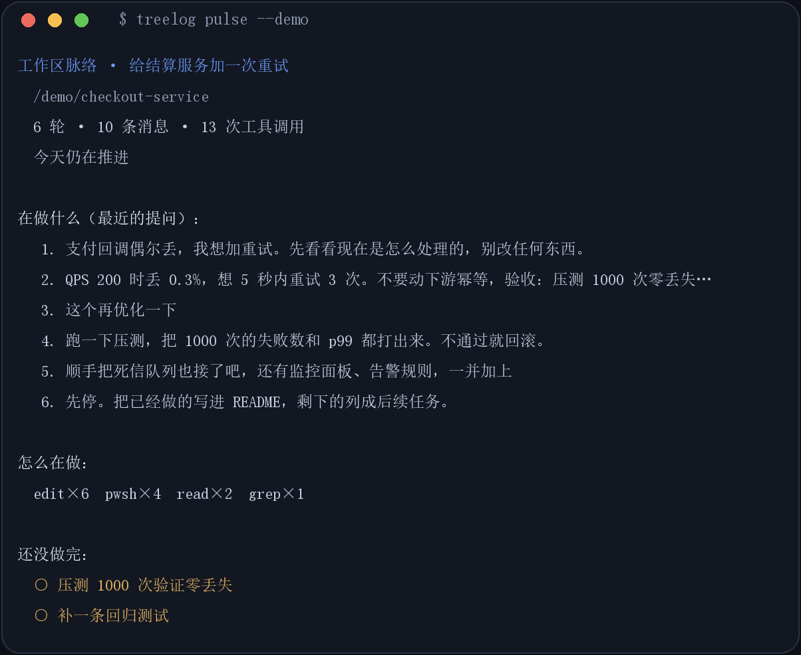
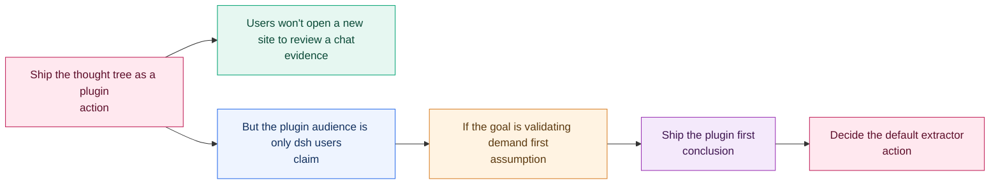

# Thinking TreeLog · 思维树

[](https://github.com/Xocean996/thinking-treelog/actions/workflows/ci.yml)
[](https://www.npmjs.com/package/@thinking-treelog/cli)
[](https://www.npmjs.com/package/@thinking-treelog/core)
[](https://www.npmjs.com/package/@thinking-treelog/mcp)
[](LICENSE)
[](#requirements)

**Your AI session already contains the reasoning. This reads it back to you.**

You talk to an AI for four hours. Somewhere in there the design got decided, a wrong
turn got abandoned, and a question you asked badly cost you twenty minutes. Then you close
the tab and all of it is gone — not the code, the *reasoning*.



Thinking TreeLog reads the transcript you already have and gives you:

```
$ npx -y @thinking-treelog/cli pulse --demo

工作区脉络 · 给结算服务加一次重试
  /demo/checkout-service
  6 轮 · 10 条消息 · 13 次工具调用
  今天仍在推进

在做什么（最近的提问）：
   1. 支付回调偶尔丢，我想加重试。先看看现在是怎么处理的，别改任何东西。
   2. QPS 200 时丢 0.3%，想 5 秒内重试 3 次。不要动下游幂等，验收：压测 1000 次零丢失…
   3. 这个再优化一下
   4. 跑一下压测，把 1000 次的失败数和 p99 都打出来。不通过就回滚。
   5. 顺手把死信队列也接了吧，还有监控面板、告警规则，一并加上

怎么在做：
  edit×6  pwsh×4  read×2  grep×1

还没做完：
  ○ 压测 1000 次验证零丢失
  ○ 补一条回归测试

建议：
  1. ［superpowers］ 接着做完「压测 1000 次验证零丢失」
     未完成的 todo 是唯一明确的下一步；别开新线。

提问质量（最近 6 条，均值 53）：
  ◐50 ●76 ○44 ◐68 ○32 ◐50
```

Three things no other tool does together:

- **It reads the real transcript**, not a paste. Session logs are decoded straight from
  disk (zstd frame by frame — every append is its own frame).
- **It reviews your questions**, not just your code. Each one gets a score, a list of what
  it left out, and a rewrite that adds the missing acceptance line.
- **It names the move**, not a platitude. Every suggestion is a specific skill
  (`writing-plans`, `systematic-debugging`) picked from the work stage it detected.

## Try it in 30 seconds

No dsh history? Run the recorded demo — it uses the same pipeline as a live read:

```bash
npx -y @thinking-treelog/cli pulse --demo
```

```
工作区脉络 · 给结算服务加一次重试
  /demo/checkout-service
  10 条消息 · 13 次工具调用

在做什么（最近的提问）：
   1. 支付回调偶尔丢，我想加重试。先看看现在是怎么处理的，别改任何东西。
   2. QPS 200 时丢 0.3%，想 5 秒内重试 3 次。不要动下游幂等，验收：压测 1000 次零丢失…
   3. 这个再优化一下
   4. 跑一下压测，把 1000 次的失败数和 p99 都打出来。不通过就回滚。
   5. 顺手把死信队列也接了吧，还有监控面板、告警规则，一并加上

还没做完：
  ○ 压测 1000 次验证零丢失
  ○ 补一条回归测试

建议：
  1. ［superpowers］ 接着做完「压测 1000 次验证零丢失」
     未完成的 todo 是唯一明确的下一步；别开新线。

提问质量（最近 6 条，均值 53）：
  ◐50 ●76 ○44 ◐68 ○32 ◐50
```

Note the last two lines. Question 2 scores **76** — it states a measurement, a bound, and
an acceptance line. Question 5 scores **32** — it stacks four goals into one sentence.
That gap is the whole point: the tool tells you which of your own questions wasted a round.

With dsh history on the machine, drop `--demo`:

```bash
npx -y @thinking-treelog/cli pulse
```

Or read a repo instead of a conversation:

```bash
npx -y @thinking-treelog/cli rhythm .
```

### Any transcript, not just dsh

```bash
treelog pulse --file chat.txt
```

Blank-line separated blocks become prompts, so an export from any tool works. The same
request asked three ways:

```
我想给登录加个验证码                                              ○44
顺手把注册、找回密码、手机绑定也做一下吧，顺便优化下 UI              ○32
给 /login 加图形验证码，不用第三方。验收：不带 captcha 返回 400      ●76
```

Same intent. Only the third one tells you when it is done — and it scores 44 points
higher. That number is the thing this tool is for.

### The report you actually have to write: `treelog weekly`

```bash
treelog weekly . --days 7
```

Fridays, under time pressure, someone reconstructs a week from memory. This takes it from
git — including the part nobody wants to admit in a status update.

```markdown
# 周报 · thinking-treelog

周期：2026-10-23 → 2026-10-24（近 7 天）

**41 次提交 · 2 个活跃日 · +14254 / −1021 行**

## 交付了什么
- 功能：25 次
- 修复：15 次
- 测试：1 次

## 精力花在哪
| 文件 | 改动次数 | 新增 | 删除 |
|---|---|---|---|
| `packages/dsh-plugin/client.js` | 34 | +4314 | −498 |
| `packages/cli/lib/commands.mjs` | 13 | +944 | −129 |

## 需要说明的
- **27 次改动只动了源码、没动测试**——这是最值得在评审里说清楚的部分。
  - `a27f828` feat: real panel screenshots
  - `56a5254` feat(panel): visual polish
- 6 次提交在 23 点后——连续熬夜通常会在两周内变成 bug。

## 下周只改一件事
- 补 1 条针对最高频改动文件的测试（`packages/dsh-plugin/client.js`）。
```

Three things it does that a `git log --oneline` cannot:

- **risk, not activity** — a commit that changed source and no test is flagged, because
  that is what a reviewer will ask about
- **effort, not count** — `client.js` touched 34 times says more than "41 commits"
- **one action, never ten** — a report with ten follow-ups gets none of them done

Every number is computed; the judgement is left to you, and the footer says so.

Two refinements matter in practice:

```bash
treelog weekly . --since-last-tag     # report per release, not per calendar week
treelog weekly repo-a repo-b repo-c   # one report per repo, in one command
treelog daily .                       # today only: what moved, what you asked
```

`--since-last-tag` falls back to the day window when the repository has no tag, so
it is safe to leave in a script. `daily` answers the standup question that sits
between `retro` (one session) and `weekly` (seven days).

The same report is available to an agent — no CLI needed:

```
weekly_report { path: ".", days: 7 }
```

### Close the loop: `treelog retro`

```bash
treelog retro --demo
```

Writes a Markdown retrospective — the thing you would otherwise write by hand at the end of
a session, or not at all:

```markdown
# 复盘 · 给结算服务加一次重试

**6 次提问 · 13 次工具调用 · 历时 52 分钟 · 提问均值 53**

## 完成情况
- [x] 给回调加退避重试
- [ ] 压测 1000 次验证零丢失
- [ ] 补一条回归测试

## 提问质量
| # | 分数 | 提问 | 缺什么 |
|---|---|---|---|
| 2 | 76 | QPS 200 时丢 0.3%… | 没交代现状 |
| 3 | 44 | 这个再优化一下 | 信息量偏少、没有验收标准 |
| 5 | 32 | 顺手把死信队列… | 没有验收标准、塞了多个目标 |

## 最该改写的一条
> 顺手把死信队列也接了吧，还有监控面板、告警规则，一并加上

## 下次注意
- 一次只提一个目标——这轮有 1 条提问把多件事塞进了一句。
- 每条提问带一行验收：做完时能跑通什么。
```

Paste it into the PR description, or into next week's plan. The unfinished boxes become the
next session's todo list.

## How it differs

| | Reads your real session | Reviews your questions | Names the next move | No server, no key |
|---|---|---|---|---|
| **Thinking TreeLog** | ✅ decodes the log | ✅ score + rewrite | ✅ picks a skill | ✅ |
| Chat log / export | ✅ but raw text | ❌ | ❌ | ✅ |
| Obsidian Canvas, markmap | ❌ you draw by hand | ❌ | ❌ | ✅ |
| LangSmith / Langfuse | ⚠️ only instrumented apps | ❌ traces, not questions | ❌ | ❌ hosted |
| Prompt managers | ❌ snippets | ❌ | ❌ | ✅ |

The claim is narrow and deliberate: **the transcript already holds the reasoning — this
reads it back, scores how you asked, and names the next move.** It is not a canvas, not a
tracer, and not a prompt library.

## What it ships as

| Package | What it is | Who it's for |
|---|---|---|
| [`@thinking-treelog/cli`](packages/cli) | `treelog pulse / rhythm / lint / plan / trace / tree / export / diff` | Anyone in a terminal |
| [`@thinking-treelog/mcp`](packages/mcp) | Zero-dependency MCP server (stdio), 10 tools | Claude Code, Cursor, Codex, any MCP client |
| [`@thinking-treelog/dsh-plugin`](packages/dsh-plugin) | A panel inside [dsh](https://github.com/deepseek-ai), with canvas, hover reviews, annotations | DeepSeek Harness users |
| [`@thinking-treelog/core`](packages/core) | Pure extraction / layout / review / export logic | Anyone building an adapter |

All four share one engine; the plugin adds a canvas on top of the same functions the CLI
uses.

## The panel

Click **分析工作区** and it reads the session you are in, then draws it:

- every question becomes a node, sized and coloured by the work stage it detected
- hovering shows the review: **优点 / 不足 / 下一步**, plus the superpowers skill to invoke
- double-click jumps back to that message in the conversation and flashes it
- any node takes your own annotation; **发布批注** writes it into the input box
- **＋ 创新想法** hangs your own innovation branch under any node
- **AI 深评** sends one node to your own model for a content review (key stays on your machine)

## What the parser actually produces

`treelog export` on a design doc:



---

## Why this exists

Three problems show up again and again when people work with AI:

1. **Reasoning evaporates.** The chat log records *what* was said, not *how* the
   conclusion was reached — so it can't be reviewed, argued with, or reused.
2. **Token burn from re-explaining.** Every new session re-describes context that a
   structured tree could have preserved in a few hundred tokens.
3. **No fair comparison of options.** Linear chat makes it almost impossible to hold two
   competing hypotheses side by side and see exactly where they diverge.

A tree fixes the representation problem. Once reasoning has structure, you can navigate
it, branch it, and diff it.

---

## What it does

### Inside dsh

- **Paste → tree.** Drop in a conversation, a plan, or your own notes; get a typed tree.
- **Zero-friction input.** `Ctrl+Enter` parses, a clipboard button pulls the last thing
  you copied, and dragging a `.md` file onto the panel loads it.
- **Plan awareness.** A superpowers plan is recognised by its `### Task` structure: tasks
  and steps become the tree, and the panel applies the plan rules instead of the prose
  rules — so interface drift shows up without leaving dsh.
- **Project import.** Drag a repository folder onto the panel (or use 导入项目): it reads
  the `.md` / `.json` files it can find — skipping `node_modules`, `dist`, `.git` — and
  builds a tree of the package, its stack, top-level modules, docs, and any
  `docs/superpowers/{specs,plans}` it contains. Everything stays local.
- **Two extractors.** Local rule extraction (offline, instant, free) or any
  OpenAI-compatible endpoint for semantic extraction, with automatic fallback.
- **Time travel.** A slider reveals nodes in reasoning order, so you can replay how the
  conclusion was built instead of jumping to the end.
- **Result card in the conversation.** A one-line strip above the composer shows the
  latest tree — title, node count, finding count — and opens the panel on click. You see
  what the plugin produced without leaving the chat.
- **Focus mode.** With a node selected, press `◉`: everything outside its path and direct
  children drops to 10% opacity. Reading a 40-node argument stops being a squint.
- **Fly-to navigation.** Click any node and the canvas glides to centre it. The toolbar
  carries root / previous issue / next issue / centre / focus / fit controls, and the arrow
  keys walk the tree (↑ parent, ↓ child/next sibling, Home root, Enter re-centre).
- **Branch experiments.** Fork any node into a parallel branch and compare alternatives.
- **Search + type filter.** Find "every assumption" or "where did we mention pricing".
- **Edit in place.** Every node's label, text, type, and confidence is editable; add
  children, delete nodes (children re-attach to the parent).
- **Reasoning lint.** The panel runs the same rules as the CLI and links each finding
  straight to the offending node.
- **Decision status.** Mark nodes proposed / accepted / rejected / superseded; rejected
  branches render dashed and stay visible for the record.
- **Export.** Markdown outline, Mermaid flowchart, ADR, JSON, or copy to clipboard.
- **Local-first.** Trees and API keys live in `localStorage`. Nothing is uploaded except
  the text you explicitly send to the endpoint you configured.

### Inside any MCP client

```
build_thought_tree    conversation text → tree JSON
thought_tree_markdown tree JSON → Markdown outline
thought_tree_mermaid  tree JSON → Mermaid flowchart
thought_tree_stats    tree JSON → depth, type mix, branches, weak claims
lint_thought_tree     tree JSON → reasoning-gap findings + severity summary
thought_tree_adr      tree JSON → Architecture Decision Record
lint_plan             plan markdown → interface drift, missing verification
trace_coverage        spec + plan → which decisions have no task
project_rhythm        git history → phases, theme mix, stall, what to pick up next
workspace_pulse       dsh session logs → the thread of work + what to do next
```

### In a CI pipeline

This is the part that makes it useful beyond a single conversation: point it at the
design docs your team already writes.

```bash
treelog lint docs/adr/*.md                 # human-readable, exits 1 on errors
treelog lint docs/**/*.md --format sarif -o treelog.sarif
treelog tree docs/adr-0007.md              # ASCII tree in the terminal
treelog export docs/adr-0007.md --format adr
treelog diff design.v1.md design.v2.md     # what changed between revisions
```

`lint` catches the reasoning gaps that review usually misses:

| Rule | Severity | Catches |
|---|---|---|
| `conclusion-without-evidence` | error | a decision nobody justified |
| `orphan-node` | error | structure that doesn't connect to any root |
| `assumption-unverified` | warning | an assumption with no validation step |
| `rejected-with-descendants` | warning | a rejected option still carrying live children |
| `superseded-without-reference` | warning | a replaced decision that doesn't say what replaced it |
| `low-confidence-conclusion` | warning | a conclusion with weak support |
| `depth-exceeds` | warning | a decision chain too deep to follow |
| `unresolved-question` | warning (opt-in) | a question with no follow-up |
| `evidence-without-source` | info (opt-in) | a cited fact with no source |

Findings carry **source line numbers**, so SARIF and GitHub annotations land on the
exact paragraph, not the top of the file.

### Works with superpowers (and any structured plan)

[superpowers](https://github.com/obra/superpowers) writes implementation plans with tasks,
ordered steps, and `Consumes` / `Produces` interface declarations. Nothing checks that
interface graph — `writing-plans` asks a human (or a model) to self-review it, and that is
exactly where signature drift slips through.

```bash
treelog plan docs/superpowers/plans/2026-10-23-feature.md
treelog plan docs/superpowers/plans/2026-10-23-feature.md --tree
```

```
Plan auditing Implementation Plan
  ⚠ task-without-verification:52 「Task 2」 — Task 2 "Interface linter" has no runnable verification step
      ↳ Add a step with a command and expected output
  ✖ signature-mismatch:69 「Task 3」 — "lintPlan" is declared as "lintPlan(plan: Plan): Finding[]"
      but consumed as "lintPlan(plan): Finding[]"
  ✖ undefined-consume:69 「Task 3」 — Task 3 consumes "formatFindings" but no task produces it
  ⚠ review-focus-empty — Multi-task plan has an empty Review Focus section
4 problem(s) — 2 error, 2 warning, 0 info
```

| Rule | Catches | The self-review item it automates |
|---|---|---|
| `undefined-consume` | a task uses a symbol no task produces | spec coverage / type consistency |
| `signature-mismatch` | same symbol declared two ways | *"a function called `clearLayers()` in Task 3 but `clearFullLayers()` in Task 7"* |
| `task-without-verification` | a task has no runnable check | step granularity + TDD |
| `task-without-files` | a task names no files | file structure |
| `review-focus-empty` | no uncovered-input analysis | review focus |
| `code-block-heavy` | code blocks exceed half the plan | proportion |
| `unused-produce` | a symbol nobody consumes (opt-in) | proportion / YAGNI |

It reads the file format only. superpowers needs no patch, no fork, and no PR — the two
projects couple through the plan markdown, which is the one thing guaranteed to stay
stable.

### Trace spec → plan

`writing-plans` also asks: *"Skim each section of the spec — can you point to a task that
implements it?"* That is the gap where whole requirements silently vanish.

```bash
treelog trace docs/superpowers/specs/2026-10-23-x-design.md \
              docs/superpowers/plans/2026-10-23-x.md
```

```
superpowers-spec.md → superpowers-plan.md
  4 decisions · threshold 0.12

matched:
  ✔ Parse the plan document and extract tasks, steps…  →  Task 1: Plan parser  (0.25)
  ✔ Build an interface graph from the Consumes and P…  →  Task 2: Interface linter  (0.231)
  ✔ Render the findings in a form a human can read a…  →  Task 3: Report renderer  (0.143)

no plausible task (check by hand):
  ✖ Capture the current conversation directly so nob…

3/4 decisions point at a task, 1 need a human look
```

Two deliberate design choices:

- **It scopes to the spec's `## Decision` section.** Context and Consequences are
  background and fallout, not things anyone implements; tracing them produces noise.
- **Matching is lexical and it says so.** The score is a pointer for a human, not a
  verdict. `--fail-on unmatched` exists for teams that want the gate, but the default is
  to report and exit 0 — a wrong "missing" flag costs more trust than a missed one.
- **It also checks proportion.** A plan four times longer than its spec is usually a
  transcript of the program, not a plan:

  ```
  size: spec 18 lines → plan 82 lines (4.6×)
    ⚠ plan is much longer than the spec — likely a transcript, not a plan
  ```

### Project rhythm

The question people actually ask is "where is this project at?" — not "where is this
document at". `rhythm` reads git history and answers it:

```bash
treelog rhythm .
```

```
thinking-treelog — 项目节奏
  14 次活动 · 1 个活跃日 · 跨度 1 天 · 日均 14

当前：连续 1 天有改动

阶段：
  2026-10-23 → 2026-10-23  14 次  feature

主线：
  feature   13
  fix        1

建议：保持当前节奏，下一步接着「feat(panel): compact dock pill + display type」推进。
```

It splits history into **phases** wherever the gap exceeds two days, classifies commits
into themes, and calls a stall when nothing moved for three days. `--format tree` renders
the same reading as a thought tree; the MCP tool `project_rhythm` returns it straight into
the conversation, so "梳理一下这个项目的节奏" works from chat.

Non-git directories fall back to file modification times, so a scratch folder still answers.

### Workspace pulse — what am I actually doing?

`rhythm` reads the repo. `workspace_pulse` reads **you**: it decodes the current dsh
session log (`~/.dsh/sessions/<workspace>/<session>/session.v4.jsonl.zstd`) and reports the
thread of work.

```
工作区脉络 · 给结算服务加一次重试
  C:\work\checkout-service
  12 轮 · 9 条消息 · 31 次工具调用
  今天仍在推进

在做什么（最近的提问）：
   1. 支付回调偶尔丢，先看看现在怎么处理的，别改任何东西
   2. QPS 200 时丢 0.3%，想 5 秒内重试 3 次，验收：压测 1000 次零丢失
   3. 顺手把死信队列也接了吧

怎么在做：
  edit×9  pwsh×4  read×2  grep×1

还没做完：
  ○ 补一条回归测试

建议：
  1. ［superpowers］ 接着做完「补一条回归测试」
  2. ［treelog］ 给这段对话留一张决策树
```

The session log is **one zstd frame per append**, so it is split on the frame magic before
decompressing — the sync API only reads the first frame. Harness-injected reminders and
turn timestamps are filtered out, so the thread shows what *you* asked, not what the
runtime inserted.

Suggestions are deterministic, not generated: an unfinished todo wins, no todo after
several turns asks for a plan, a long idle gap asks you to close or drop the branch, and a
high tool-call count suggests writing a hypothesis first. Two treelog checks ride along.

### Configuration

Drop a `treelog.config.json` anywhere above the docs (it walks up to find one):

```json
{
  "preset": "recommended",
  "locale": "en",
  "maxDepth": 8,
  "ignore": ["docs/archive/**"],
  "baseline": ".treelog-baseline.json",
  "failOn": "error",
  "rules": {
    "evidence-without-source": "off",
    "depth-exceeds": "info"
  }
}
```

Presets set a posture instead of listing rules: `recommended` (default), `strict`
(turns on the opt-in rules), `relaxed` (errors only). Explicit `rules` always win.

### Baseline: only fail on new drift

A repo with years of docs has hundreds of existing findings. Adopting a linter that
turns the build red on day one never works, so:

```bash
treelog lint docs/ --baseline-write      # accept the current state
treelog lint docs/ --baseline .treelog-baseline.json   # only new findings fail
```

The baseline stores stable fingerprints (rule + file + label), so renaming a heading
does not resurface every historical finding.

### Suppress one thing, with a reason

```md
<!-- treelog-ignore conclusion-without-evidence -->
<!-- treelog-ignore -->              silence the whole file
```

### Output formats

`text` (default), `json`, `sarif` (Code Scanning), `github` (workflow annotations),
`junit` (any CI that reads JUnit XML).

SARIF output means GitHub Code Scanning renders these as inline annotations, so a
reviewer sees "this decision has no evidence" on the PR that introduced it.

```yaml
# .github/workflows/design-lint.yml
- uses: actions/checkout@v4
- uses: thinking-treelog/thinking-treelog@v1
  with:
    files: docs/**/*.md
    format: sarif
- uses: github/codeql-action/upload-sarif@v3
  with:
    sarif_file: treelog.sarif
```

---

## Screenshots

The panel is not shown. It runs inside a real workspace, and every capture of it
carries the operator's session titles, working paths and conversation text — none of
which belongs in a public repository. The command-line surfaces produce the same
analysis without anyone's data, so those are what this README shows.

The image above is generated from live output, not hand-typed:
`scripts/render-demo.py` reads `treelog pulse --demo` and draws the card, so it cannot
drift from what the tool actually prints.

Paste a discussion, get a typed tree: node cards carry the type colour as a spine and a
wash, links inherit the child's type, and the reasoning lint runs on the result.
A superpowers plan is recognised by its `### Task` structure; the panel switches to the
plan rules and reports interface drift with line numbers (see the CLI output below).

---

## Install

### Requirements

| Command | Node |
|---|---|
| `weekly`, `rhythm`, `lint`, `plan`, `trace`, `tree`, `export`, `diff` | **18 or newer** |
| `pulse` (reads dsh session logs) | **22.15 or newer** — it needs zlib zstd |
| `retro` | 18, unless you point it at a live session |

On an older Node everything except `pulse` still loads and runs; `pulse` prints a
version message instead of a stack trace. If you only want to analyse a transcript
you exported yourself, `pulse --file notes.txt` works on Node 18.

Nothing needs an API key, a server, or a network connection.

### 1. As a dsh plugin

The bundle is a normal dsh profile bundle. From a checkout of this repo:

```bash
# point dsh at the package directory (plugin_manager install_bundle)
# target: /absolute/path/to/thinking-treelog/packages/dsh-plugin
```

or add it to your profile by hand:

```jsonc
// ~/.dsh/profiles/<name>/package.json
{
  "dependencies": {
    "@thinking-treelog/dsh-plugin": "link:/absolute/path/to/packages/dsh-plugin"
  },
  "dsh": { "profile": { "bundles": ["...", "@thinking-treelog/dsh-plugin"] } }
}
```

Reload the page. A **思维树** icon appears in the sidebar; clicking it opens the panel.

### 2. As an MCP server

Published on npm — no checkout needed:

```jsonc
// Claude Desktop / Claude Code / Cursor — any MCP client
{
  "mcpServers": {
    "thinking-treelog": {
      "command": "npx",
      "args": ["-y", "@thinking-treelog/mcp"]
    }
  }
}
```

11 tools: thought trees, reasoning lint, plan lint, spec coverage, project rhythm,
workspace pulse, and `weekly_report`.

### 3. As a CLI

```bash
npx -y @thinking-treelog/cli pulse --demo     # see it work, no setup
npx -y @thinking-treelog/cli weekly .          # this week's report
```

Or install it globally:

```bash
npm install -g @thinking-treelog/cli
treelog pulse --demo
```

### 4. As a library

```bash
npm install @thinking-treelog/core
```

```js
import { extractWithRules, normalizeNodes, computeLayout, toMarkdown } from '@thinking-treelog/core';
import { parseMarkdown, lintTree, toSarif, toAdr } from '@thinking-treelog/core/engineering';

const nodes = normalizeNodes(extractWithRules(transcript));
const layout = computeLayout(nodes);       // { nodes, links, width, height }
console.log(toMarkdown({ title: 'Decision', nodes }));

// Engineering flavour: parse a doc, lint it, emit SARIF for code scanning.
const docNodes = parseMarkdown(await readFile('docs/adr-0007.md', 'utf8'));
const findings = lintTree(docNodes);
console.log(JSON.stringify(toSarif(findings, { file: 'docs/adr-0007.md' }), null, 2));
```

---

## How extraction works

**Rule mode** is deterministic and offline:

1. Split on `。！？!?；;` and newlines.
2. Classify each sentence by connective cues (`因此` → conclusion, `因为` → evidence,
   `如果` → assumption, `但是` → rebuttal, `必须` → constraint, `应该` → action,
   trailing `？` → question).
3. Wire the tree: default chaining, **rebuttals fork** from the claim they attack,
   **enumerations fan out** from a shared anchor.
4. Score confidence from hedging (`可能`/`maybe` down) and evidence markers
   (data, percentages up).

**LLM mode** asks an OpenAI-compatible model for strict JSON and then runs the same
repair pass — missing ids, dangling parents, cycles, unknown types, out-of-range
confidence. The tree always renders, even if the model misbehaves.

`scripts/consistency.test.mjs` asserts the browser copy and the core package produce
byte-identical output, so the two implementations cannot silently drift.

---

## Repository layout

```
packages/
  core/          pure engine: extract, normalize, graph, layout, export
  core/src/engineering.js
                 markdown parsing, lint rules, SARIF, ADR, tree diff
  mcp/           stdio MCP server + tool implementations
  cli/           treelog binary (lint / tree / export / diff)
  dsh-plugin/    self-contained dsh Client module (no build step)
examples/
  adr-0007-plugin-vs-site.md   a deliberately imperfect ADR to try lint on
scripts/
  smoke-client.mjs      headless check of the Client factory + slot registrations
  consistency.test.mjs  client ⇄ core parity (extraction, layout, lint, exports)
  engineering.test.mjs  markdown parsing, lint, SARIF, ADR, diff, config, baseline
  mcp.test.mjs          tool behaviour
action.yml                   GitHub Action wrapper around `treelog lint`
treelog.config.example.json  annotated config to copy into a repo
treelog.schema.json          JSON Schema for editor completion
```

The dsh Client half is deliberately self-contained: dsh loads it as a browser module
through `window.__ModuleLoader__`, so it cannot import npm packages at runtime.

---

## What's different

1. **It audits plans, not just prose.** Every tool in this space checks writing. This one
   also parses `### Task` / `Consumes` / `Produces` and checks the *interface graph* — the
   exact thing `writing-plans` asks a human to self-review, and the exact place signature
   drift hides.
2. **Two engines, one contract.** The dsh panel cannot import npm packages, so it carries
   its own copy of the engine. A parity test asserts byte-identical output across
   extraction, layout, lint, plan lint and both export formats.
3. **A tree you can stand inside.** Time-travel reveal by creation order, fly-to on click,
   keyboard roaming. Reasoning is navigated, not scrolled.
4. **Coverage tracing without an LLM.** Spec decisions are matched to plan tasks lexically,
   scoped to the spec's Decision section, reported as a pointer rather than a verdict. No
   API key, no token cost, no hallucinated "covered".
5. **Baseline by fingerprint, not by line.** Findings are keyed `rule|file|label`, so
   renaming a heading does not resurface a hundred historical findings — the failure mode
   that gets linters uninstalled in week one.
6. **Local project import.** Drop a folder; get a tree of its docs, modules and superpowers
   plans. No server, no upload, no indexing service.

The full module list lives in [docs/project-plan.md](docs/project-plan.md) — written in the
superpowers plan format, and it audits clean with this tool's own `treelog plan`.

## Performance

Measured on a real corpus — 54 markdown files (339 KiB) from an installed skill
library, parsed and linted end to end:

```
files:  54  (339 KiB)
time:   36 ms parse+lint  (wall 84 ms)
mean:   0.67 ms/file   p95: 2.38 ms
rate:   9,435 KiB/s
nodes:  4138   findings: 55   failures: 0
```

That is roughly 55k files/second of parse throughput on ordinary hardware, with zero
parser failures on real-world markdown (nested lists, fenced code, tables, HTML).
Reproduce it against any directory:

```bash
node scripts/bench.mjs path/to/docs
```

## Development

```bash
npm install          # links the workspace packages
npm run verify       # core + consistency + client + MCP tests
```

All tests run in-process with `node:test`; no browser and no network required.

---

## Roadmap

- [x] Rule extraction with typed nodes
- [x] Tidy tree layout + SVG canvas
- [x] Time-travel reveal, search, type filter
- [x] Branch experiments, node editing, deletion
- [x] Markdown / Mermaid / JSON export
- [x] Zero-dependency MCP server
- [x] **Markdown/ADR parsing → tree**
- [x] **Reasoning lint with SARIF output + GitHub Action**
- [x] **Decision status (proposed / accepted / rejected / superseded)**
- [x] **Tree diff between document revisions**
- [x] **Config file, presets, ignore globs, inline suppressions**
- [x] **Baseline mode: only new drift fails the build**
- [x] **JUnit + GitHub annotations output**
- [x] **Source line numbers on every finding**
- [x] **MCP tools for plan audit and spec coverage**
- [x] **Proportion check (code-block ratio, plan vs spec length)**
- [ ] **Capture the current dsh conversation directly** (no pasting)
- [ ] Import ChatGPT / Claude export JSON
- [ ] Branch diff view (two branches side by side)
- [ ] HTML report for reviewers who don't read terminals
- [ ] Optional LLM-assisted "find the weakest link" review

The first unchecked item is the one that decides whether this becomes a daily tool or
stays a demo. It is the next thing to build.

---

## License

MIT — see [LICENSE](LICENSE).
