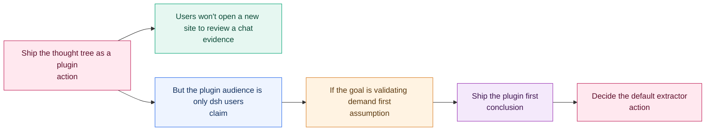

# Thinking TreeLog · 思维树

**Turn any conversation into a thought tree you can travel back through.**

Most AI chats are a stream of text: once a decision scrolls off screen, the reasoning
behind it is gone. Thinking TreeLog parses a conversation into a **tree of reasoning
steps** — question → claim → evidence → assumption → conclusion — so you can see where
an argument forked, replay it step by step, and run a second branch against the first.

It ships as three things that share one engine:

| Package | What it is | Who it's for |
|---|---|---|
| [`@thinking-treelog/dsh-plugin`](packages/dsh-plugin) | A sidebar panel inside [dsh](https://github.com/deepseek-ai) | People working in the DeepSeek Harness |
| [`@thinking-treelog/mcp`](packages/mcp) | A zero-dependency MCP server (stdio) | Claude Code, Cursor, Codex, any MCP client |
| [`@thinking-treelog/cli`](packages/cli) | `treelog lint / export / diff / tree` | Design docs, ADRs, and CI pipelines |
| [`@thinking-treelog/core`](packages/core) | Pure extraction / layout / lint / export logic | Anyone building their own adapter |

> **Status: v0.2.** Extraction, tree layout, branch experiments, search, export, and the
> CI lint all work today. Automatic conversation capture (instead of pasting) is the next
> milestone — see [Roadmap](#roadmap).

What the parser actually produces (this diagram is generated by `treelog export`):



---

## Why this exists

Three problems show up again and again when people work with AI:

1. **Reasoning evaporates.** The chat log records *what* was said, not *how* the
   conclusion was reached — so it can't be reviewed, argued with, or reused.
2. **Token burn from re-explaining.** Every new session re-describes context that a
   structured tree could have preserved in a few hundred tokens.
3. **No fair comparison of options.** Linear chat makes it almost impossible to hold two
   competing hypotheses side by side and see exactly where they diverge.

A tree fixes the representation problem. Once reasoning has structure, you can navigate
it, branch it, and diff it.

---

## What it does

### Inside dsh

- **Paste → tree.** Drop in a conversation, a plan, or your own notes; get a typed tree.
- **Two extractors.** Local rule extraction (offline, instant, free) or any
  OpenAI-compatible endpoint for semantic extraction, with automatic fallback.
- **Time travel.** A slider reveals nodes in reasoning order, so you can replay how the
  conclusion was built instead of jumping to the end.
- **Branch experiments.** Fork any node into a parallel branch and compare alternatives.
- **Search + type filter.** Find "every assumption" or "where did we mention pricing".
- **Edit in place.** Every node's label, text, type, and confidence is editable; add
  children, delete nodes (children re-attach to the parent).
- **Reasoning lint.** The panel runs the same rules as the CLI and links each finding
  straight to the offending node.
- **Decision status.** Mark nodes proposed / accepted / rejected / superseded; rejected
  branches render dashed and stay visible for the record.
- **Export.** Markdown outline, Mermaid flowchart, ADR, JSON, or copy to clipboard.
- **Local-first.** Trees and API keys live in `localStorage`. Nothing is uploaded except
  the text you explicitly send to the endpoint you configured.

### Inside any MCP client

```
build_thought_tree    conversation text → tree JSON
thought_tree_markdown tree JSON → Markdown outline
thought_tree_mermaid  tree JSON → Mermaid flowchart
thought_tree_stats    tree JSON → depth, type mix, branches, weak claims
lint_thought_tree     tree JSON → reasoning-gap findings + severity summary
thought_tree_adr      tree JSON → Architecture Decision Record
```

### In a CI pipeline

This is the part that makes it useful beyond a single conversation: point it at the
design docs your team already writes.

```bash
treelog lint docs/adr/*.md                 # human-readable, exits 1 on errors
treelog lint docs/**/*.md --format sarif -o treelog.sarif
treelog tree docs/adr-0007.md              # ASCII tree in the terminal
treelog export docs/adr-0007.md --format adr
treelog diff design.v1.md design.v2.md     # what changed between revisions
```

`lint` catches the reasoning gaps that review usually misses:

| Rule | Severity | Catches |
|---|---|---|
| `conclusion-without-evidence` | error | a decision nobody justified |
| `orphan-node` | error | structure that doesn't connect to any root |
| `assumption-unverified` | warning | an assumption with no validation step |
| `rejected-with-descendants` | warning | a rejected option still carrying live children |
| `superseded-without-reference` | warning | a replaced decision that doesn't say what replaced it |
| `low-confidence-conclusion` | warning | a conclusion with weak support |
| `depth-exceeds` | warning | a decision chain too deep to follow |
| `unresolved-question` | warning (opt-in) | a question with no follow-up |
| `evidence-without-source` | info (opt-in) | a cited fact with no source |

Findings carry **source line numbers**, so SARIF and GitHub annotations land on the
exact paragraph, not the top of the file.

### Works with superpowers (and any structured plan)

[superpowers](https://github.com/obra/superpowers) writes implementation plans with tasks,
ordered steps, and `Consumes` / `Produces` interface declarations. Nothing checks that
interface graph — `writing-plans` asks a human (or a model) to self-review it, and that is
exactly where signature drift slips through.

```bash
treelog plan docs/superpowers/plans/2026-10-23-feature.md
treelog plan docs/superpowers/plans/2026-10-23-feature.md --tree
```

```
Plan auditing Implementation Plan
  ⚠ task-without-verification:52 「Task 2」 — Task 2 "Interface linter" has no runnable verification step
      ↳ Add a step with a command and expected output
  ✖ signature-mismatch:69 「Task 3」 — "lintPlan" is declared as "lintPlan(plan: Plan): Finding[]"
      but consumed as "lintPlan(plan): Finding[]"
  ✖ undefined-consume:69 「Task 3」 — Task 3 consumes "formatFindings" but no task produces it
  ⚠ review-focus-empty — Multi-task plan has an empty Review Focus section
4 problem(s) — 2 error, 2 warning, 0 info
```

| Rule | Catches | The self-review item it automates |
|---|---|---|
| `undefined-consume` | a task uses a symbol no task produces | spec coverage / type consistency |
| `signature-mismatch` | same symbol declared two ways | *"a function called `clearLayers()` in Task 3 but `clearFullLayers()` in Task 7"* |
| `task-without-verification` | a task has no runnable check | step granularity + TDD |
| `task-without-files` | a task names no files | file structure |
| `review-focus-empty` | no uncovered-input analysis | review focus |
| `unused-produce` | a symbol nobody consumes (opt-in) | proportion / YAGNI |

It reads the file format only. superpowers needs no patch, no fork, and no PR — the two
projects couple through the plan markdown, which is the one thing guaranteed to stay
stable.

### Configuration

Drop a `treelog.config.json` anywhere above the docs (it walks up to find one):

```json
{
  "preset": "recommended",
  "locale": "en",
  "maxDepth": 8,
  "ignore": ["docs/archive/**"],
  "baseline": ".treelog-baseline.json",
  "failOn": "error",
  "rules": {
    "evidence-without-source": "off",
    "depth-exceeds": "info"
  }
}
```

Presets set a posture instead of listing rules: `recommended` (default), `strict`
(turns on the opt-in rules), `relaxed` (errors only). Explicit `rules` always win.

### Baseline: only fail on new drift

A repo with years of docs has hundreds of existing findings. Adopting a linter that
turns the build red on day one never works, so:

```bash
treelog lint docs/ --baseline-write      # accept the current state
treelog lint docs/ --baseline .treelog-baseline.json   # only new findings fail
```

The baseline stores stable fingerprints (rule + file + label), so renaming a heading
does not resurface every historical finding.

### Suppress one thing, with a reason

```md
<!-- treelog-ignore conclusion-without-evidence -->
<!-- treelog-ignore -->              silence the whole file
```

### Output formats

`text` (default), `json`, `sarif` (Code Scanning), `github` (workflow annotations),
`junit` (any CI that reads JUnit XML).

SARIF output means GitHub Code Scanning renders these as inline annotations, so a
reviewer sees "this decision has no evidence" on the PR that introduced it.

```yaml
# .github/workflows/design-lint.yml
- uses: actions/checkout@v4
- uses: thinking-treelog/thinking-treelog@v1
  with:
    files: docs/**/*.md
    format: sarif
- uses: github/codeql-action/upload-sarif@v3
  with:
    sarif_file: treelog.sarif
```

---

## Screenshots

| Thought tree | Node detail |
|---|---|
| _add `docs/screenshot-tree.png`_ | _add `docs/screenshot-node.png`_ |

To produce them: open the panel, press **示例** (sample), then **解析成思维树**.

---

## Install

### 1. As a dsh plugin

The bundle is a normal dsh profile bundle. From a checkout of this repo:

```bash
# point dsh at the package directory (plugin_manager install_bundle)
# target: /absolute/path/to/thinking-treelog/packages/dsh-plugin
```

or add it to your profile by hand:

```jsonc
// ~/.dsh/profiles/<name>/package.json
{
  "dependencies": {
    "@thinking-treelog/dsh-plugin": "link:/absolute/path/to/packages/dsh-plugin"
  },
  "dsh": { "profile": { "bundles": ["...", "@thinking-treelog/dsh-plugin"] } }
}
```

Reload the page. A **思维树** icon appears in the sidebar; clicking it opens the panel.

### 2. As an MCP server

```jsonc
// Claude Desktop / Claude Code / Cursor — any MCP client
{
  "mcpServers": {
    "thinking-treelog": {
      "command": "node",
      "args": ["/absolute/path/to/packages/mcp/server.mjs"]
    }
  }
}
```

After publishing, this becomes `npx -y @thinking-treelog/mcp`.

### 3. As a CLI

```bash
# from this repo
node packages/cli/bin/treelog.mjs lint examples/adr-0007-plugin-vs-site.md

# after publishing
npx -y @thinking-treelog/cli lint docs/adr/*.md
```

### 4. As a library

```bash
npm install @thinking-treelog/core
```

```js
import { extractWithRules, normalizeNodes, computeLayout, toMarkdown } from '@thinking-treelog/core';
import { parseMarkdown, lintTree, toSarif, toAdr } from '@thinking-treelog/core/engineering';

const nodes = normalizeNodes(extractWithRules(transcript));
const layout = computeLayout(nodes);       // { nodes, links, width, height }
console.log(toMarkdown({ title: 'Decision', nodes }));

// Engineering flavour: parse a doc, lint it, emit SARIF for code scanning.
const docNodes = parseMarkdown(await readFile('docs/adr-0007.md', 'utf8'));
const findings = lintTree(docNodes);
console.log(JSON.stringify(toSarif(findings, { file: 'docs/adr-0007.md' }), null, 2));
```

---

## How extraction works

**Rule mode** is deterministic and offline:

1. Split on `。！？!?；;` and newlines.
2. Classify each sentence by connective cues (`因此` → conclusion, `因为` → evidence,
   `如果` → assumption, `但是` → rebuttal, `必须` → constraint, `应该` → action,
   trailing `？` → question).
3. Wire the tree: default chaining, **rebuttals fork** from the claim they attack,
   **enumerations fan out** from a shared anchor.
4. Score confidence from hedging (`可能`/`maybe` down) and evidence markers
   (data, percentages up).

**LLM mode** asks an OpenAI-compatible model for strict JSON and then runs the same
repair pass — missing ids, dangling parents, cycles, unknown types, out-of-range
confidence. The tree always renders, even if the model misbehaves.

`scripts/consistency.test.mjs` asserts the browser copy and the core package produce
byte-identical output, so the two implementations cannot silently drift.

---

## Repository layout

```
packages/
  core/          pure engine: extract, normalize, graph, layout, export
  core/src/engineering.js
                 markdown parsing, lint rules, SARIF, ADR, tree diff
  mcp/           stdio MCP server + tool implementations
  cli/           treelog binary (lint / tree / export / diff)
  dsh-plugin/    self-contained dsh Client module (no build step)
examples/
  adr-0007-plugin-vs-site.md   a deliberately imperfect ADR to try lint on
scripts/
  smoke-client.mjs      headless check of the Client factory + slot registrations
  consistency.test.mjs  client ⇄ core parity (extraction, layout, lint, exports)
  engineering.test.mjs  markdown parsing, lint, SARIF, ADR, diff, config, baseline
  mcp.test.mjs          tool behaviour
action.yml                   GitHub Action wrapper around `treelog lint`
treelog.config.example.json  annotated config to copy into a repo
treelog.schema.json          JSON Schema for editor completion
```

The dsh Client half is deliberately self-contained: dsh loads it as a browser module
through `window.__ModuleLoader__`, so it cannot import npm packages at runtime.

---

## Development

```bash
npm install          # links the workspace packages
npm run verify       # core + consistency + client + MCP tests
```

All tests run in-process with `node:test`; no browser and no network required.

---

## Roadmap

- [x] Rule extraction with typed nodes
- [x] Tidy tree layout + SVG canvas
- [x] Time-travel reveal, search, type filter
- [x] Branch experiments, node editing, deletion
- [x] Markdown / Mermaid / JSON export
- [x] Zero-dependency MCP server
- [x] **Markdown/ADR parsing → tree**
- [x] **Reasoning lint with SARIF output + GitHub Action**
- [x] **Decision status (proposed / accepted / rejected / superseded)**
- [x] **Tree diff between document revisions**
- [x] **Config file, presets, ignore globs, inline suppressions**
- [x] **Baseline mode: only new drift fails the build**
- [x] **JUnit + GitHub annotations output**
- [x] **Source line numbers on every finding**
- [ ] **Capture the current dsh conversation directly** (no pasting)
- [ ] Import ChatGPT / Claude export JSON
- [ ] Branch diff view (two branches side by side)
- [ ] HTML report for reviewers who don't read terminals
- [ ] Optional LLM-assisted "find the weakest link" review

The first unchecked item is the one that decides whether this becomes a daily tool or
stays a demo. It is the next thing to build.

---

## License

MIT — see [LICENSE](LICENSE).
